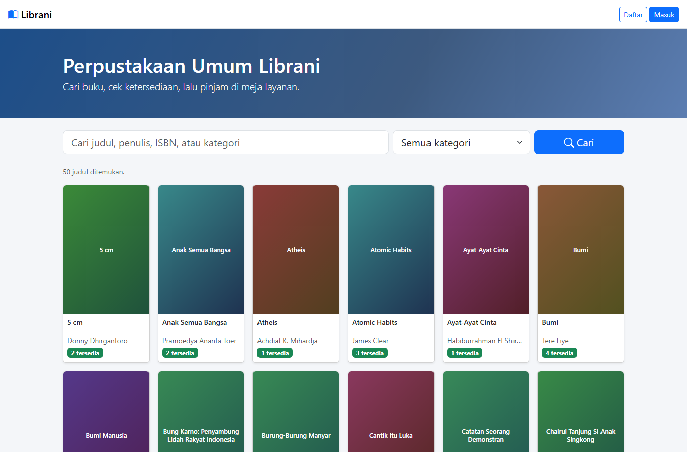

# Librani — Sistem Informasi Perpustakaan

Aplikasi web perpustakaan umum/daerah untuk mengelola koleksi buku per eksemplar (lengkap dengan foto sampul), keanggotaan, peminjaman, pengembalian, denda, reservasi, dan laporan. Dibangun dengan **PHP native + MySQL** tanpa framework.

- **Aplikasi online:** _(isi URL InfinityFree setelah deploy, misal https://librani.infinityfreeapp.com)_
- **Dokumen kebutuhan:** [prd_librani.md](prd_librani.md) · **Desain teknis:** [docs/superpowers/specs/2026-11-17-librani-design.md](docs/superpowers/specs/2026-11-17-librani-design.md)
- **ERD:** [docs/erd.dbml](docs/erd.dbml) (tempel ke dbdiagram.io) → `docs/erd.png`



## Pemenuhan ketentuan tugas

| No | Ketentuan | Implementasi |
| --- | --- | --- |
| 1 | Basis data | MySQL/MariaDB, 14 tabel InnoDB berelasi (20 foreign key) — [database/schema.sql](database/schema.sql) |
| 2 | Login / register / dashboard | Login 3 role, register anggota + verifikasi petugas, dashboard berbeda per role |
| 3 | File master | Kategori, Penerbit, Rak, Buku (+ foto sampul), Eksemplar, Anggota, User petugas |
| 4 | File transaksi | Peminjaman (header–detail), Pengembalian, Pembayaran denda, Perpanjangan, Reservasi |
| 5 | File report | 7 laporan dengan filter, tampilan cetak, export PDF & Excel |
| 6 | Hosting gratis | InfinityFree + SSL gratis |

## Fitur

**Semua role**
- Login dengan username/email, logout aman (tombol Back tidak membuka halaman lagi), ganti password & profil.
- Halaman yang bukan haknya → *403 — Akses ditolak* (dicek di server).

**Admin** — CRUD semua master termasuk user petugas, pengaturan aturan (batas pinjam, lama pinjam, denda per hari, dll.), membebaskan denda dengan alasan, semua laporan, 5 buku terpopuler di dashboard.

**Petugas** — verifikasi pendaftar (kode `AGT-2026-0001` dibuat otomatis), kelola buku & eksemplar (kode `BK0001-01` otomatis), peminjaman banyak eksemplar per transaksi dengan kartu sampul, pengembalian dengan denda otomatis, pembayaran denda + kuitansi, perpanjangan, penyerahan reservasi, cetak label barcode & kartu anggota ber-QR, scan kamera.

**Anggota** — katalog bergambar dengan pencarian, pinjaman aktif & jatuh tempo, perpanjang sendiri, denda, reservasi dengan antrean, kartu anggota.

**Aturan bisnis** (bisa diubah admin, disalin ke transaksi saat dibuat)
- Maks. 3 eksemplar, lama pinjam 7 hari, denda Rp1.000/hari/eksemplar (hari kalender).
- Anggota dengan denda belum lunas / pinjaman terlambat / masa berlaku habis tidak bisa meminjam, memperpanjang, atau mereservasi.
- Rusak 50% / hilang 100% harga buku. Perpanjangan 1x (+7 hari). Reservasi maks. 2 judul, batas ambil 2 hari.
- Setiap proses simpan transaksi memakai transaksi database (BEGIN … COMMIT/ROLLBACK); status eksemplar hanya diubah oleh transaksi.

## Akun demo

| Role | Username | Password |
| --- | --- | --- |
| Admin | `admin` | `admin123` |
| Petugas | `petugas1` | `petugas123` |
| Anggota | `anggota1` | `anggota123` |

Anggota contoh lain memakai password `anggota123` (mis. `anggota2` punya denda & pinjaman terlambat). Segera ganti password admin di hosting.

## Instalasi lokal (XAMPP)

1. Pasang XAMPP (PHP 8.2+), aktifkan ekstensi `gd`, `zip`, `intl` di `php.ini`, lalu Start **Apache** dan **MySQL**.
2. Clone ke `C:\xampp\htdocs\librani` (atau buat junction: `mklink /J C:\xampp\htdocs\librani <folder repo>`).
3. Salin `config/config.example.php` menjadi `config/config.php`, sesuaikan `BASE_URL` (`http://localhost/librani`) dan akun database.
4. Pasang Dompdf untuk export PDF: `composer install` (tanpa ini aplikasi tetap jalan, tombol PDF disembunyikan).
5. Isi database — pilih salah satu:
   - **Dari terminal (disarankan):** `php database/seed.php` — membuat database `librani`, data contoh, dan memproses foto sampul dari `database/seed-covers/`.
   - **Lewat phpMyAdmin:** buat database `librani` (collation `utf8mb4_unicode_ci`), impor `database/librani.sql`.
6. Buka `http://localhost/librani`.

## Deploy ke InfinityFree

1. Buat akun hosting + subdomain, aktifkan **SSL gratis**, buat database MySQL dari panel.
2. Di lokal: `php database/seed.php && php database/export.php` → menghasilkan `database/librani.sql` yang aman diimpor di MySQL maupun MariaDB.
3. phpMyAdmin hosting → impor `database/librani.sql`.
4. FileZilla → upload ke `htdocs/` semua file **kecuali** `.git/`, `tests/`, `docs/`, `.superpowers/`; **termasuk** `vendor/` dan `uploads/cover/` hasil seeder.
5. Buat `config/config.php` di server: `APP_ENV` = `hosting`, `BASE_URL` = `https://<subdomain>`, host/nama/user/password database dari panel (host **bukan** `localhost`).
6. Cek: halaman login lewat HTTPS, `https://<subdomain>/config/config.php` → 403.

> Data contoh memakai tanggal relatif terhadap hari seeder dijalankan. Jalankan ulang langkah 2–3 sehari sebelum presentasi agar ada pinjaman yang "jatuh tempo hari ini" dan "terlambat".

### Foto sampul data contoh
Simpan foto di `database/seed-covers/` dengan nama sesuai [DAFTAR.md](database/seed-covers/DAFTAR.md) (`BK0001.jpg` … `BK0050.jpg`), lalu jalankan ulang `php database/seed.php` (dan `export.php` untuk hosting). Buku tanpa foto tampil dengan sampul pengganti berisi judul.

## Struktur folder

```
config/        config.example.php (di-commit), config.php (kredensial, di-.gitignore)
includes/      init, db, helpers, csrf, auth, upload, nomor, master, katalog,
               sirkulasi (pinjam/kembali/denda/perpanjangan), reservasi, dashboard, laporan, layout/
modules/       auth, dashboard, katalog, anggota (halaman milik sendiri),
               master/*, transaksi/*, laporan, pengaturan — satu file per halaman
assets/        css, js, vendor (Bootstrap, DataTables, Chart.js, SweetAlert2, SheetJS, JsBarcode, qrcodejs, html5-qrcode)
uploads/       cover/ (+thumb/), anggota/ — eksekusi PHP dimatikan lewat .htaccess
database/      schema.sql, seed.php, buku.php (data buku asli), export.php, librani.sql, seed-covers/
tests/         cek.php (tes logika), smoke.php (tes semua halaman per role)
```

## Keamanan

Password `password_hash()`/`password_verify()`, semua query PDO prepared statement, output di-escape `htmlspecialchars()`, token CSRF di semua form POST, `session_regenerate_id()` saat login, upload dicek dari MIME asli + nama acak + gambar di-encode ulang, folder `config/`, `database/`, `tests/` tidak bisa diakses dari web.

## Pengujian

```bash
php tests/cek.php                              # 326 tes logika pada database librani_test (dibuat otomatis)
php database/seed.php && php tests/smoke.php   # login 3 role, buka ±200 halaman/form/PDF, cek 403 & error PHP
```

## Teknologi

PHP 8.2+ native + PDO · MySQL/MariaDB (InnoDB) · Bootstrap 5.3 + Bootstrap Icons · DataTables 2 · Chart.js 4 · SweetAlert2 · Dompdf 3 (PDF) · SheetJS (Excel) · JsBarcode, qrcodejs, html5-qrcode (barcode/QR/scan).
